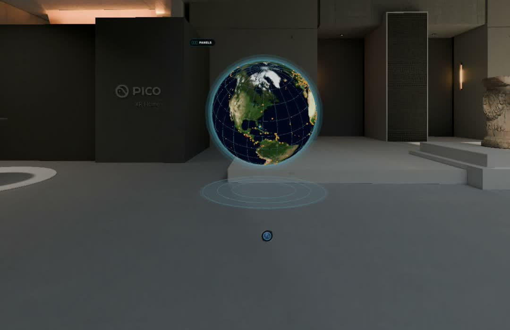
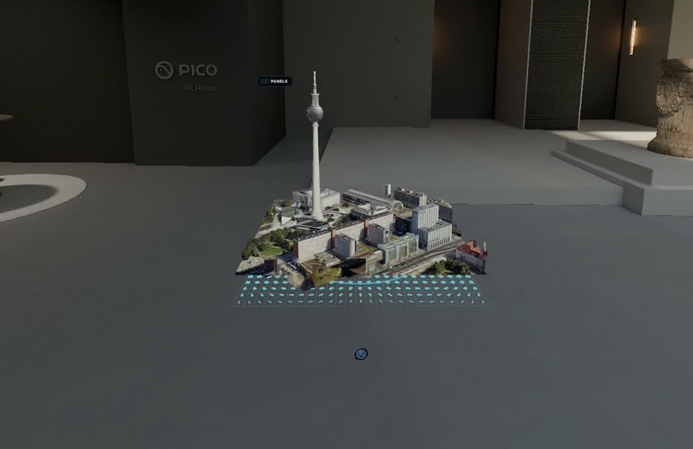
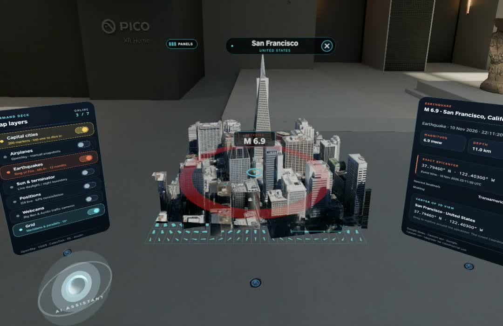

<div align="center">

# 🌍 Earth Explorer

### A photorealistic Earth that floats in your room, and real cities that rise out of it.

Spatial app for **PICO OS 6**, built with the PICO Spatial SDK.
Live aircraft, earthquakes, satellites, the Sun, public cameras, and
Google Photorealistic 3D Tiles, all inside one volumetric window.

[](https://developer.picoxr.com/)
[](https://developer.picoxr.com/)
[](https://kotlinlang.org/)
[](LICENSE)

_A spatial take on [God's Eye View](https://github.com/bilawalsidhu/gods-eye-view)._

https://github.com/user-attachments/assets/784ba626-a220-4eb2-9c17-bda5f688aa53

</div>

---

<div align="center">

**[Why](#-why-this-exists) · [What's on the globe](#-whats-on-the-globe) · [Earth to city](#-earth-to-city) · [Setup](#-setup) · [Scripted demos](#-scripted-demos) · [Under the hood](#-under-the-hood) · [Data sources](#-data-sources-and-attribution) · [Limitations](#-limitations)**

</div>

---

<table>
  <tr>
    <td></td>
    <td></td>
    <td></td>
  </tr>
  <tr>
    <td align="center"><sub>The globe boots as a wireframe and settles into photo texture.</sub></td>
    <td align="center"><sub>Tap a capital: Earth splits into plates and the real city rises.</sub></td>
    <td align="center"><sub>Earthquake epicenter in the native city mesh with the command deck open.</sub></td>
  </tr>
</table>

## 🌐 Why this exists

[God's Eye View](https://github.com/bilawalsidhu/gods-eye-view) by
[Bilawal Sidhu](https://github.com/bilawalsidhu) showed that a spy-satellite
simulator can be built entirely from public signals: flight transponders,
orbital elements, seismographs, traffic cameras. It runs in a browser.

Earth Explorer asks what that idea feels like when the globe is an object in
the room instead of a window on a screen. You walk around it. You pick a city
with your hand and the sphere comes apart into plates while the real
photogrammetry of that city grows out of a scanning grid in front of you. The
live layers follow the same rule as the original: everything comes from a
public provider, nothing is simulated to look busy, and a feed that is down
says so.

It is a prototype and a demo piece, not a product. The code is here so other
people building for PICO OS 6 can see how a volumetric window, native meshes,
3D Tiles streaming, and live data fit together in one Spatial SDK app.

## 🎛️ What's on the globe

The globe sits in a volumetric window with a dark "command deck" around it:
a map-layers panel on the left, details on the right, and a small assistant
orb. All panels start hidden and toggle together with the **PANELS** button
in the top-left corner of the volume. Each layer has its own accent color and
sweeps a bright meridian around the globe when it comes online.

| Layer | What it shows | Source |
| --- | --- | --- |
| **Capital cities** | 200 gold markers you can tap to dive into the city. London opens at Big Ben, Berlin beside the TV Tower, Washington at the White House. | Natural Earth (public domain) |
| **Airplanes** | Low-poly airliners from a global state-vector snapshot, with per-aircraft callsign, altitude, speed and heading. Manual refresh, no polling. | [OpenSky Network](https://opensky-network.org/) |
| **Earthquakes / Ring of Fire** | Twelve months of M 5.4+ events, depth encoded by color, the newest ones ringing. Tap one to open the native mesh at its epicenter. | [USGS](https://earthquake.usgs.gov/fdsnws/event/1/) |
| **Sun & terminator** | Subsolar point and the day/night boundary computed locally from UTC, with NASA Black Marble city lights on the night side. | Local astronomy |
| **Positions** | The GPS constellation on six orbital shells, propagated locally from public elements, plus a live ISS marker with a pulsing halo. | [CelesTrak](https://celestrak.org/), [Where the ISS at?](https://wheretheiss.at/) |
| **Webcams** | Public traffic cameras placed at their published coordinates. Selecting one opens its city and plays the feed in a window beside it. | [TfL JamCams](https://tfl.gov.uk/info-for/open-data-users/), City of Austin |
| **Grid** | A 15° graticule over the sphere. | Visual only |

Layers stop their update loops when switched off. Nothing is written to disk;
the tile cache lives in memory for the session only.

## 🏙️ Earth to city

Selecting a place is a single continuous motion, not a scene change:

1. A pulsing cyan reticle locks onto the location and the globe turns it toward you.
2. The textured sphere splits into 500 curved plates that tint cyan, switch to
   wireframe and settle as a flat scanning grid on the floor of the volume.
3. Google Photorealistic 3D Tiles stream in through Cesium ion. Each tile rises
   out of the grid as a wireframe and develops its photo texture; the grid
   retracts once the first view has settled.
4. Drag to pan. The city stays upright, a compass rose and a 100 m scale bar sit
   on the floor, and the coordinates in the details panel follow your hand.
5. The close ring on the city label runs the whole thing in reverse: the city
   sinks to cyan and the plates fly back into the sphere.

Under the city, a 7×7 neighborhood of 320 m regions is prefetched around the
view so panning rarely hits a blank tile. See [Under the hood](#-under-the-hood).

### Assistant orb

The small orb under the layers panel is a **scripted** voice assistant for
demos. Pinch and hold it to "listen": a prepared question types out, the orb
turns violet while the real action runs, then the answer appears. The script
presents a scenario earthquake (M 6.9 at the foot of the Transamerica Pyramid,
clearly labelled as a scenario, not a USGS observation), dives into the city,
and reveals the epicenter with shockwaves rolling across the floor. No audio is
recorded or transmitted. It exists so the trailer could be dubbed.

## 🚀 Setup

Earth Explorer targets **PICO OS 6** (Android API 35) and runs in the PICO
emulator on macOS, Windows or Linux. You need:

- A JDK 17 or newer and the Android SDK (Android Studio is the easiest way to get both).
- Node.js 18+ for the PICO CLI.
- A free [Cesium ion](https://ion.cesium.com/) account for the Google Photorealistic 3D Tiles stream.

### 1. Install the PICO CLI and the emulator

```sh
npm install -g @picoxr/pico-cli
pico-cli emulator doctor          # checks Android SDK, emulator and JDK prerequisites
pico-cli emulator setup           # prints repair guidance if anything is missing
```

Create and start a PICO OS 6 virtual device. The first start downloads the
emulator bundle, which can take a while:

```sh
pico-cli emulator create --avd Pico_Emulator_6_1 -y
pico-cli emulator start --avd Pico_Emulator_6_1 --wait-timeout 180 -y
pico-cli emulator status
```

### 2. Clone and add your Cesium ion token

```sh
git clone https://github.com/nigelhartman/earth-explorer.git
cd earth-explorer
cp local.properties.example local.properties
```

Open `local.properties` and set `CESIUM_ION_TOKEN` to a token from your Cesium
ion account. Use a **restricted** token (read access to assets plus geocoding
only), because the value is compiled into the APK as a client credential. The
file is ignored by Git. The environment variable `CESIUM_ION_TOKEN` takes
precedence if set. Make sure the Google Photorealistic 3D Tiles asset
(ion asset `2275207`) is added to your ion account.

### 3. Build, install, launch

```sh
./gradlew assembleDebug
pico-cli app install --replace app/build/outputs/apk/debug/app-debug.apk
pico-cli app launch com.example.earthexplorer --activity .platform.LaunchActivity
```

The globe boots as a wireframe in front of you. In the emulator, switch to the
eye-and-hand interaction mode in the bottom toolbar, point at the globe and
click to select, drag to rotate, and use `W A S D` plus `Q`/`E` to walk and
rise around it.

### 4. Make it smooth (optional, recommended for recordings)

The emulator drops to 1 Hz when it thinks its window is idle, which also makes
native texture uploads crawl. Start it with adaptive vsync disabled:

```sh
pico-cli emulator start --avd Pico_Emulator_6_1 \
  --args='-no-snapshot-load -no-snapshot-save -no-adjust-vsync -vsync-rate 60'
```

To record a take without the emulator chrome, record on the device side:

```sh
pico-cli shell screenrecord --time-limit 60 --bit-rate 24000000 /sdcard/take.mp4
pico-cli files pull /sdcard/take.mp4 ./recordings/take.mp4
```

### Tests

```sh
./gradlew testDebugUnitTest lintDebug      # coordinates, clipping, layers, orbits, caches
./gradlew connectedDebugAndroidTest        # GLB parsing, textures, feed parsing on the emulator
```

The connected test runner uninstalls the app afterwards; reinstall to explore.

## 🎬 Scripted demos

Debug builds register a broadcast receiver that drives the app through the
same store calls the hand gestures use. It is how the trailer recording was
made repeatable. It is absent from release builds.

```sh
A="adb shell am broadcast -a com.example.earthexplorer.DIRECT -p com.example.earthexplorer"

$A --es cmd city --ef lat 52.520815 --ef lon 13.411050 --es name Berlin --es country Germany
$A --es cmd pan --ef dx 180 --ef dy 0 --el ms 2000     # eased hand pan
$A --es cmd earth                                      # fly the plates back into the sphere
$A --es cmd panels --ez on true                        # show the command deck
$A --es cmd layer --es name earthquakes --ez on true   # capitals|aircraft|earthquakes|sun|positions|webcams|grid
$A --es cmd focus --ef lat 37.7946 --ef lon -122.4030 --ez blink true
$A --es cmd assist --el hold 3000                      # pinch-and-hold the orb for 3 s
$A --es cmd reset
```

A second debug receiver, `CityDebugReceiver`, exposes layer toggles, ISS
focus, quake and webcam selection for smoke tests. Both log under `Director`
and `LayerSmokeTest`, and neither prints tokens or authenticated URLs.

## 🔧 Under the hood

```
app/src/main/java/com/example/earthexplorer
├── platform/   LaunchActivity, SpatialApplication, DirectorReceiver
├── content/    native meshes, globe + city volume, transition, panels, assistant orb
└── data/       Cesium 3D Tiles client, mesh neighborhood, map layers, providers, stores
```

- **One volume for Earth and city.** `CityVolume.kt` owns a persistent root in
  the volumetric window. Dragging translates that root while the window clips
  the boundaries; an invisible stationary hit box keeps hit testing cheap so
  photo meshes never need physics geometry.
- **3D Tiles without Cesium Native.** `CesiumTiles.kt` traverses the live
  tileset hierarchy with inherited transforms and session parameters, decodes
  the embedded GLB geometry and photo textures, and keeps Earth coordinates in
  double precision until the final conversion to a local east/up/south frame.
- **Rolling mesh neighborhood.** `MeshNeighborhood.kt` divides the ground into
  320 × 320 m regions. The visible view loads first, then a 7×7 neighborhood in
  distance order. Crossing a region boundary reuses 42 of the 49 regions and
  prefetches the new outer ring. Compressed neighbor GLBs stay in a session-only
  memory cache capped at 192 MiB or one third of the app heap.
- **The transition is real geometry.** The sphere is clipped into 500 plates
  with interpolated texture coordinates; city tiles are clipped at fragment
  boundaries. A reverse snapshot stays prepared while a city is open, so
  returning to Earth never rebuilds hundreds of native meshes first.
- **Live layers are honest.** Each provider's timestamp, delay, rate limit and
  error state is shown. Stale ISS reports disappear after two minutes rather
  than being relabelled; GPS positions are labelled as two-body predictions,
  not telemetry.

Stack: Kotlin 2.1, PICO Spatial SDK 6.1.9 (core, UI platform/foundation/design,
sense, tracking), Android Gradle Plugin 8.13, minSdk 35.

## 📡 Data sources and attribution

| Data | Provider | Terms |
| --- | --- | --- |
| Photorealistic city meshes | Google Photorealistic 3D Tiles via [Cesium ion](https://cesium.com/platform/cesium-ion/) | Your own ion token, Google Maps Platform terms |
| Place names | Cesium ion Google geocoder | Same token |
| Capital cities | [Natural Earth](https://www.naturalearthdata.com/) | Public domain |
| Aircraft | [OpenSky Network](https://opensky-network.org/apidoc/rest.html) | Anonymous quota, four credits per global refresh, one-minute minimum interval enforced |
| Earthquakes | [USGS FDSN event service](https://earthquake.usgs.gov/fdsnws/event/1/) | Public domain |
| GPS elements | [CelesTrak OMM](https://celestrak.org/NORAD/documentation/gp-data-formats.php) | Cached, fetched at most every two hours per the [usage policy](https://celestrak.org/usage-policy.php) |
| ISS position | [Where the ISS at?](https://wheretheiss.at/w/developer) | Every five seconds while the layer is on |
| London cameras | TfL JamCams | Powered by TfL Open Data. Contains OS data © Crown copyright and database rights |
| Austin cameras | City of Austin, TX | City of Austin open data |
| Night lights | NASA Black Marble | NASA imagery |

No webcam API keys are used. No synthetic fallback data is shown for any feed.

## ⚠️ Limitations

- This is a prototype. It has been exercised in the PICO emulator and on
  PICO OS 6; expect rough edges elsewhere.
- Tile coverage and detail depend on Google's data for the location. Offshore
  or remote earthquake epicenters often have no mesh; the app says so instead
  of substituting a map.
- The 3D Tiles client handles the embedded GLB content of this one dataset at
  a fixed neighborhood detail. Arbitrary ion assets, Draco-compressed payloads
  and offline exports are not implemented.
- Orbital displays are visually compressed to fit the window and are not meant
  for navigation or antenna pointing. The earthquake layer is historical
  seismicity, not a warning service.
- The assistant is a scripted demo, not a language model, and does not listen.

## 🙏 Credits

- [God's Eye View](https://github.com/bilawalsidhu/gods-eye-view) by Bilawal
  Sidhu (MIT) for the idea, the attitude toward public data, and the webcam
  provider selection that this project borrows.
- [Cesium](https://cesium.com/) and Google for the 3D Tiles stream.
- OpenSky Network, USGS, CelesTrak, Where the ISS at?, TfL, the City of Austin,
  Natural Earth and NASA for keeping their data open.
- The PICO Spatial SDK team for the volumetric window container that makes the
  Earth-to-city transition possible in one scene.

## 📄 License

[MIT](LICENSE) © 2026 Nigel Hartman. Third-party data remains under its own
providers' terms listed above.
